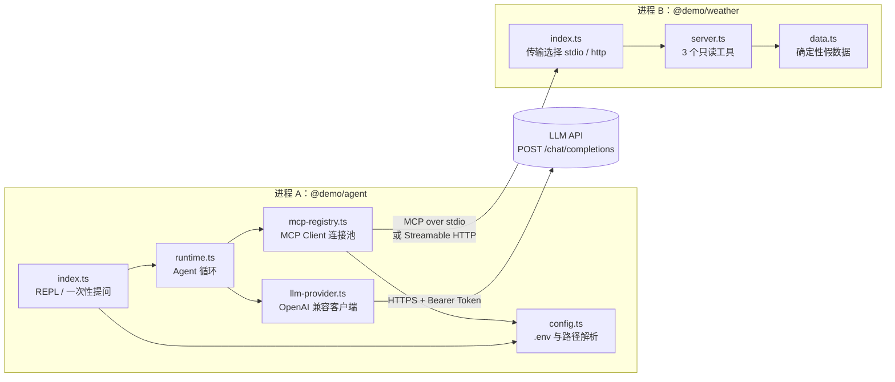
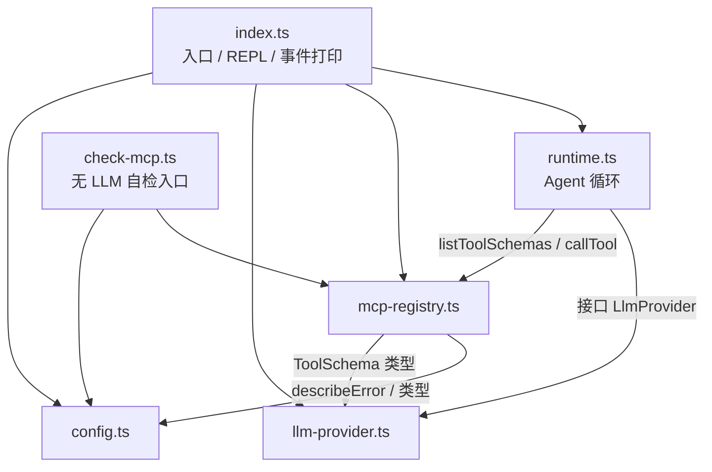
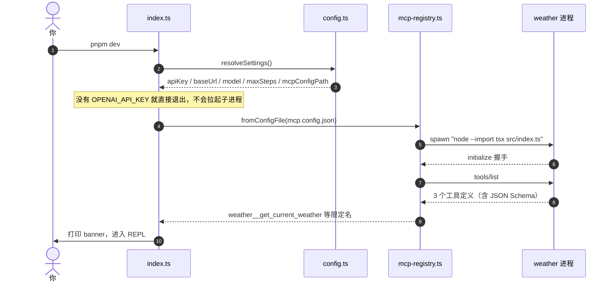
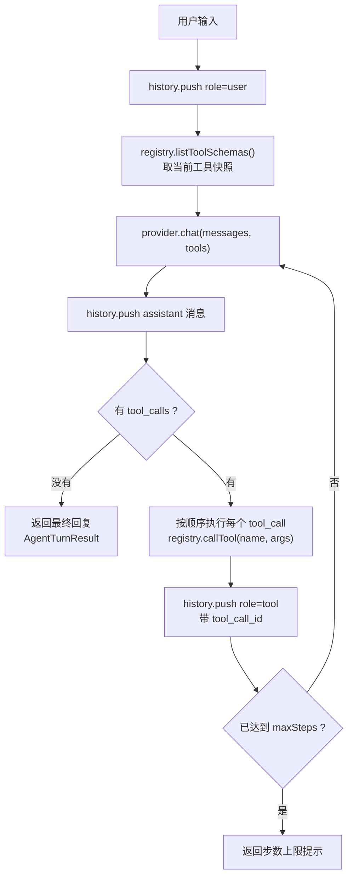
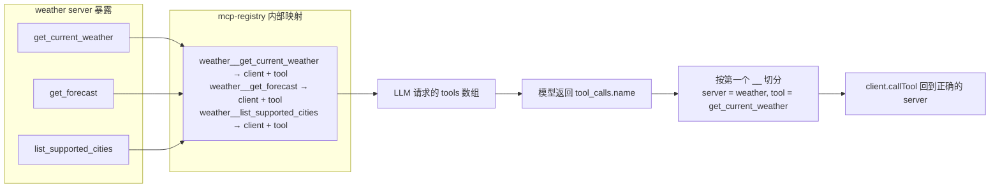
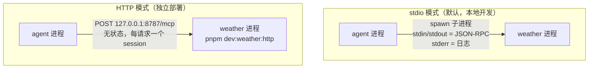
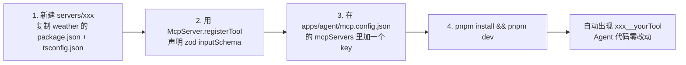

# agent-mcp-demo 技术方案

> 一句话概括：一个 TypeScript + pnpm workspace 的最小可运行样例，用 **两个独立的 Node 进程**（Agent 进程、MCP Server 进程）演示「LLM 工具调用闭环」的工程架构。进程之间只走 MCP 协议，不互相 `import` 业务代码。

本文配合 `README.md` 阅读：README 讲怎么跑，本文讲为什么这么设计、数据怎么流、哪里需要配置。

---

## 1. 设计目标与非目标

| 类型 | 内容 |
| --- | --- |
| 目标 | 打通 `用户输入 → LLM → 工具调用 → MCP Server → 结果回填 → LLM → 最终回答` 的完整闭环 |
| 目标 | 把 LLM 供应商、MCP 连接管理、Agent 循环三件事拆成互不感知的模块，可单独替换 |
| 目标 | 保留真实的**进程边界**：Agent 与 Server 可以独立构建、独立部署、独立升级 |
| 目标 | 同一份业务代码同时支持 stdio 与 Streamable HTTP 两种 MCP 传输 |
| 非目标 | 不引入 Turborepo / Nx / 复杂构建流水线（两个包 + `pnpm -r` 足够） |
| 非目标 | 不提前抽 `packages/shared`（还没有真实的跨包复用需求） |
| 非目标 | 不做鉴权、限流、可观测体系、微服务部署 |
| 非目标 | 工具调用是串行的，暂不做并行 fan-out、重试、缓存 |

---

## 2. 架构总览



**关键点**
- Agent 是**父进程**：stdio 模式下由它按配置拉起 weather 子进程；HTTP 模式下 weather 是别人部署的服务，Agent 只是客户端。
- 唯一的出网点是 `llm-provider.ts`。weather server 完全离线，数据由字符串哈希确定性生成。
- `runtime.ts` 只依赖 `LlmProvider` 接口和 `McpRegistry`，**不知道** LLM 是谁、工具从哪来 —— 这是替换成本最低的切面。

---

## 3. 模块职责与依赖方向



| 文件 | 职责 | 关键实现 |
| --- | --- | --- |
| `apps/agent/src/index.ts` | CLI 入口：banner、REPL、斜杠命令、一次性提问、优雅退出 | `main()` 在 `apps/agent/src/index.ts:63` |
| `apps/agent/src/config.ts` | 找 workspace 根、加载 `.env`、解析 MCP 配置路径 | `resolveSettings()` 在 `apps/agent/src/config.ts:62` |
| `apps/agent/src/llm-provider.ts` | 内部消息模型 ⇄ OpenAI wire 格式双向转换，发起 HTTP 请求 | `chat()` 在 `apps/agent/src/llm-provider.ts:90` |
| `apps/agent/src/mcp-registry.ts` | 建连、聚合工具、按限定名路由调用、渲染结果、统一关闭 | `callTool()` 在 `apps/agent/src/mcp-registry.ts:146` |
| `apps/agent/src/runtime.ts` | Agent 主循环：多轮 tool-calling + 会话历史 + 步数上限 | `run()` 在 `apps/agent/src/runtime.ts:56` |
| `apps/agent/src/check-mcp.ts` | 不调用 LLM 的链路自检（发现工具、真实调用、错误路径） | `apps/agent/src/check-mcp.ts:9` |
| `servers/weather/src/server.ts` | 用 zod 声明 inputSchema，注册 3 个只读工具 | `createWeatherServer()` 在 `servers/weather/src/server.ts:27` |
| `servers/weather/src/index.ts` | 传输选择：默认 stdio；`--http` 起无状态 HTTP 服务 | `runStdio()`/`runHttp()` 在 `servers/weather/src/index.ts:18` |
| `servers/weather/src/data.ts` | FNV 哈希 + 季节/昼夜曲线生成确定性天气 | `snapshot()` 在 `servers/weather/src/data.ts:75` |

---

## 4. 核心链路

### 4.1 启动时序



单个 server 建连失败只会打一行日志并跳过，**不影响其他 server 和整个进程启动**（见 `loadConfigFile()` 的 try/catch，`apps/agent/src/mcp-registry.ts:74`）。

### 4.2 Agent 循环



- **工具清单在每次 `run()` 开头取一次**（`apps/agent/src/runtime.ts:58`），循环内复用同一份快照；因此运行期热插拔 server 后，下一次提问就能看到新工具。
- **工具串行执行**：实现简单、日志可读、副作用可控；并行化是明确的演进项。
- **步数上限**（`AGENT_MAX_STEPS`，默认 8）是防止模型无限自我调用的唯一护栏。

### 4.3 消息在 LLM 侧的形态

一次「北京天气」提问，`messages` 数组按时间顺序长这样：

```jsonc
[
  { "role": "system",    "content": "You are a concise assistant..." },
  { "role": "user",      "content": "北京今天天气怎么样？" },
  { "role": "assistant", "content": null,
    "tool_calls": [{ "id": "call_abc", "type": "function",
      "function": { "name": "weather__get_current_weather",
                    "arguments": "{\"city\":\"北京\",\"unit\":\"c\"}" } }] },
  { "role": "tool",      "tool_call_id": "call_abc",
    "name": "weather__get_current_weather",
    "content": "{ \"city\": \"Beijing\", \"temperature\": \"13.8°C\", ... }" },
  { "role": "assistant", "content": "北京今天晴，13.8°C……" }
]
```

| role | 由谁产生 | 作用 |
| --- | --- | --- |
| `system` | `DEFAULT_SYSTEM_PROMPT`（`apps/agent/src/runtime.ts:25`） | 约定工具命名规则、要求不猜数据、要求用用户语言回答 |
| `user` | REPL 输入 | 用户意图 |
| `assistant` | LLM | 要么是纯文本答案，要么带 `tool_calls` 请求调用工具 |
| `tool` | `mcp-registry` 的执行结果 | 用 `tool_call_id` 与请求配对，把 MCP 返回的文本喂回模型 |

> 注意 `assistant.tool_calls[].function.arguments` 是**字符串**，`tool.content` 也是字符串。JSON 序列化/反序列化都收敛在 `llm-provider.ts` 的 `toWireMessage()` / `fromWireMessage()` 里，业务代码只见结构化对象。解析失败时降级为 `{ "_raw": "..." }`，不会抛异常打断循环。

### 4.4 工具命名与路由



- 限定名规则：`<serverKey>__<toolName>`，分隔符常量在 `apps/agent/src/mcp-registry.ts:13`。
- 解决**多 server 同名工具冲突**，同时保留路由所需信息；模型的 `inputSchema` 原样透传（`toJsonObject()`）。
- 切分只按**第一个** `__`，所以工具名自身含下划线是安全的。

---

## 5. 传输层：stdio vs Streamable HTTP



| 维度 | stdio | Streamable HTTP |
| --- | --- | --- |
| 生命周期 | Agent 拉起并负责关闭 | 独立进程，Agent 只连不管 |
| 配置 | `command` / `args` / `cwd` / `env` | `url` / `headers` |
| 日志 | 子进程 stderr 直接继承到终端 | server 自己的 stderr |
| 适用 | 本地开发、单机 | 远程部署、多 Agent 共享一个 Server |
| 本仓库实现 | `StdioClientTransport` | 客户端 `StreamableHTTPClientTransport`；服务端 `StreamableHTTPServerTransport`（`sessionIdGenerator: undefined` 的无状态模式） |

HTTP 模式的取舍（见 `handleRequest()`，`servers/weather/src/index.ts:49`）：
- 每个 POST 请求新建一个 `McpServer` + transport，请求结束即关闭 —— 无需 session 存储，代价是不支持服务端主动推送（SSE 长连接、`notifications/*`）。
- 只接受 `POST /mcp`；其他路径 404，其他方法 405，JSON 解析失败 400，未捕获异常 500。
- **切换传输不需要改任何业务代码**，只换配置文件：这正是把 MCP 细节全部收敛进 `mcp-registry.ts` 的收益。

---

## 6. 需要配置的地方

### 6.1 三步跑起来

```bash
pnpm install                                  # 1. 安装 workspace 依赖
cp .env.example .env && $EDITOR .env          # 2. 填 LLM 凭证（唯一必填项）
pnpm --filter @demo/agent check:mcp           # 3. 先验证 MCP 链路（不需要 Key）
pnpm dev                                      #    再启动 Agent
```

### 6.2 环境变量

| 变量 | 必填 | 默认值 | 作用 |
| --- | --- | --- | --- |
| `OPENAI_API_KEY` | ✅ | 无 | 缺失时进程直接退出（exit code 1），且不会拉起任何 MCP 子进程 |
| `OPENAI_BASE_URL` | ❌ | `https://api.openai.com/v1` | 任何 OpenAI 兼容端点，实际请求 `<baseUrl>/chat/completions` |
| `OPENAI_MODEL` | ❌ | `gpt-4o-mini` | 模型名，需支持 function calling |
| `AGENT_MAX_STEPS` | ❌ | `8` | 单次提问的最大 LLM 往返轮数 |
| `MCP_CONFIG` | ❌ | `apps/agent/mcp.config.json` | 指定别的 MCP 配置文件，相对路径按 **cwd** 解析 |
| `WEATHER_HTTP_HOST` | ❌ | `127.0.0.1` | HTTP 模式监听地址 |
| `WEATHER_HTTP_PORT` | ❌ | `8787` | HTTP 模式监听端口 |
| `WEATHER_TRANSPORT` | ❌ | `stdio` | 设为 `http` 等价于加 `--http` 参数 |
| `NO_COLOR` | ❌ | 无 | 设置后关闭 REPL 的 ANSI 颜色 |

`.env` 查找顺序：`process.cwd()` → workspace 根 → `apps/agent`，第一个存在的生效；底层用 Node 原生 `process.loadEnvFile()`，**已存在的环境变量不会被覆盖**（所以命令行前缀 `OPENAI_MODEL=xxx pnpm dev` 优先级最高）。

### 6.3 `mcp.config.json` 字段

```jsonc
{
  "mcpServers": {
    "weather": {                                  // key 即工具前缀 weather__*
      "transport": "stdio",                       // 可省略，默认 stdio
      "command": "node",
      "args": ["--import", "tsx", "src/index.ts"],
      "cwd": "servers/weather",                   // 相对 workspace 根解析
      "env": { "SOME_KEY": "value" },             // 显式传给子进程
      "disabled": false                           // true 则跳过不连
    },
    "remote": {
      "transport": "http",
      "url": "https://example.com/mcp",
      "headers": { "authorization": "Bearer ..." }
    }
  }
}
```

| 字段 | 适用传输 | 说明 |
| --- | --- | --- |
| `transport` | 全部 | `"stdio"`（默认）或 `"http"` |
| `command` / `args` | stdio | 子进程命令；`cwd` 用于定位包目录 |
| `cwd` | stdio | 相对路径基准是**含 `pnpm-workspace.yaml` 的目录**（向上查找，见 `apps/agent/src/config.ts:14`），绝对路径原样使用 |
| `env` | stdio | ⚠️ 子进程默认**只继承白名单变量**（SDK 的 `getDefaultEnvironment()`：PATH、HOME、LANG 等）。Server 需要的密钥必须显式写在这里 |
| `url` / `headers` | http | `headers` 会挂到每个请求上，适合放鉴权 |
| `disabled` | 全部 | 临时摘掉某个 server，不用删配置 |

生产部署时把 stdio 的启动命令换成构建产物即可，无需改代码：

```jsonc
{ "transport": "stdio", "command": "node", "args": ["dist/index.js"], "cwd": "servers/weather" }
```

### 6.4 接入一个新的 MCP Server



第三方现成的 MCP Server（filesystem、github、postgres 等）同理，只要把 `command`/`args` 填对就能用；不需要进 workspace，也不需要写任何适配代码。

### 6.5 TypeScript / workspace 约定

| 配置 | 值 | 为什么 |
| --- | --- | --- |
| `module` / `moduleResolution` | `NodeNext` | 纯 ESM，源码内的相对导入必须写 `.js` 后缀 |
| `strict` + `noUncheckedIndexedAccess` | 开启 | 数组/索引访问强制处理 `undefined`，MCP 返回结构本来就是弱类型 |
| `verbatimModuleSyntax` | 开启 | 类型导入必须写 `import type`，编译产物无歧义 |
| `types` | `["node"]` | 不引 DOM，避免 `fetch`/`Response` 类型来源混乱 |
| 各包 `rootDir`/`outDir` | `src` → `dist` | 包之间构建产物完全隔离，可独立发布 |
| 依赖归属 | 各自 `package.json` | Agent 不依赖 zod，Server 不依赖 Agent；根目录只管脚本与工具链 |

---

## 7. 错误处理与降级策略

| 场景 | 行为 | 位置 |
| --- | --- | --- |
| 缺 `OPENAI_API_KEY` | 打印指引 + exit 1，**不拉起任何子进程** | `apps/agent/src/index.ts:63` |
| MCP 配置文件不存在 | 打日志，以「无工具」模式继续运行 | `apps/agent/src/mcp-registry.ts:74` |
| 配置文件 JSON 非法 | 抛错终止（配置错误应尽早失败） | `apps/agent/src/mcp-registry.ts:74` |
| 某个 server 连不上 | 记录日志并跳过，其余 server 正常工作 | `apps/agent/src/mcp-registry.ts:74` |
| LLM 返回 4xx/5xx | 抛错，消息里带状态码 + 响应体前 600 字符 | `apps/agent/src/llm-provider.ts:90` |
| LLM 请求超时 | `AbortSignal.timeout`，默认 60s | `apps/agent/src/llm-provider.ts:86` |
| 模型调用了不存在的工具 | `ok=false`，把**已知工具清单**回给模型，让它自我纠正 | `apps/agent/src/mcp-registry.ts:146` |
| 工具执行抛异常 | 捕获后以 `Tool error: ...` 回填，循环继续而不是崩掉 | `apps/agent/src/runtime.ts:56` |
| 工具返回非文本内容 | image/audio/resource 降级为占位描述，保证 `content` 一定是字符串 | `apps/agent/src/mcp-registry.ts:210` |
| 城市不在支持列表 | Server 返回 `isError: true` + 引导调用 `list_supported_cities` | `servers/weather/src/server.ts:114` |
| 达到步数上限 | 返回固定提示语，并把它作为 assistant 消息写入历史 | `apps/agent/src/runtime.ts:56` |
| Ctrl-C / SIGTERM | 关闭所有 MCP 连接（连带 stdio 子进程）后退出 | `apps/agent/src/index.ts:63` |

设计原则：**工具层错误喂回模型**（模型有机会自愈），**基础设施错误抛给人类**（配置、鉴权、网络）。

---

## 8. 验证方式

| 命令 | 验证什么 | 是否需要 Key / 网络 |
| --- | --- | --- |
| `pnpm -r typecheck` | 全仓库类型正确性（strict） | 否 |
| `pnpm -r build` | 两个包都能独立编译出 `dist/` | 否 |
| `pnpm --filter @demo/agent check:mcp` | MCP 建连、工具发现、真实调用、未知工具错误路径 | 否 |
| `MCP_CONFIG=apps/agent/mcp.config.http.example.json pnpm --filter @demo/agent check:mcp` | HTTP 传输下同样的链路 | 需先 `pnpm dev:weather:http` |
| `pnpm dev "北京今天天气怎么样？"` | 完整闭环（含真实 LLM） | 是 |

不带真实 LLM 也能验证 Agent 循环：把 `OPENAI_BASE_URL` 指向任意实现了 `/chat/completions` 的桩服务即可（第一次返回 `tool_calls`、第二次返回文本，就能观察到完整的两轮往返）。

---

## 9. 演进路线

| 触发条件 | 该做什么 |
| --- | --- |
| 需要第二个业务 Server | 复制 `servers/weather` 骨架，验证多 server 聚合与命名冲突 |
| 回复太长、等待体验差 | `llm-provider.ts` 增加 SSE 流式解析，REPL 逐字打印 |
| 单轮里模型要调多个工具 | `runtime.ts` 改为 `Promise.all` 并行执行 + 单工具超时/重试 |
| 会话需要跨进程保留 | 历史持久化（JSONL / SQLite），CLI 加 `--resume` |
| 出现真实的跨包复用（日志、schema 校验） | 此时再抽 `packages/shared`，不要更早 |
| 包数量或构建依赖关系变复杂 | 此时再引入 Turborepo 做任务编排与缓存，不要更早 |
| Server 需要推送能力（进度、订阅） | HTTP 模式改为有状态 session + SSE 长连接 |

---

## 10. 常见问题

**Q：Agent 和 Server 在同一个 Git 仓库，是不是就耦合了？**
不是。仓库边界 ≠ 进程边界。它们各有 `package.json`、各自编译、各自启动，运行时只通过 MCP 协议通信。今天把 weather 拆成独立仓库或独立部署，Agent 侧只需要把配置从 stdio 换成 http。

**Q：为什么 weather 的日志走 stderr？**
stdio 传输把 stdout 当作 JSON-RPC 通道，任何多打的字符都会破坏帧解析。`StdioServerTransport` 也依赖这个约定，所以 Server 内所有日志都用 `process.stderr.write`。

**Q：为什么子进程拿不到我的环境变量？**
SDK 的 `getDefaultEnvironment()` 只透传一份安全白名单。需要传给 Server 的变量，请写进 `mcp.config.json` 的 `env` 字段。

**Q：为什么用 `node --import tsx` 而不是 `pnpm run dev` 来拉起 Server？**
`pnpm run` 会把 `> @demo/weather@0.1.0 dev` 之类的横幅写进 stdout，直接污染 JSON-RPC 通道。

**Q：在受限沙箱里跑 `tsx` 报 `listen EPERM`？**
`tsx` 需要在临时目录建 IPC unix socket，HTTP 模式还需要监听本地端口。受限环境会拦截 `listen`。可以先 `pnpm -r build`，再用 `node apps/agent/dist/index.js` 和 `node servers/weather/dist/index.js` 绕过 tsx。

**Q：想换成本地模型（Ollama / vLLM / 其他 OpenAI 兼容网关）？**
只改 `.env` 的 `OPENAI_BASE_URL` 与 `OPENAI_MODEL`。前提是模型支持 function calling；不支持的话模型永远不会返回 `tool_calls`，Agent 会退化成普通聊天。
